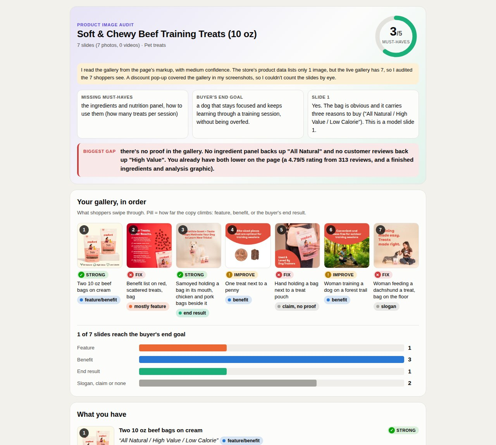

# Landra Skills

Free Claude skills for DTC brands, from [Landra](https://www.getlandra.com/?utm_source=github&utm_medium=readme&utm_campaign=landra-skills) (the landing page builder Ezra Rufino runs).

## Product Image Audit

Paste a product page link. Claude pulls every image in your gallery in order, checks the live page, looks at each image, and tells you:
- what each image does for a buyer
- which shots your category needs that you're missing, ranked
- the order to put them in
- a shot brief for every missing image
- bugs like the wrong colour or shade showing in another variant's gallery

You get it as a visual report: your real images, a score for the must-have shots, a chart of how far your image copy climbs (feature, benefit, end result), before/after rewrites, and the new order as a strip. Ask for the "text version" if you want plain text.



### Install in the Claude app
1. Download `product-image-audit.zip` from Releases. Leave it zipped.
2. In Claude: **Settings → Capabilities**. Turn on code execution, and allow network access so the skill can read your page.
3. **Customize → Skills → + → Upload a skill**, then pick the ZIP and switch it on.
4. Ask: "Audit the images on my product page: <link>"

If network access is off, the skill asks you for screenshots of your gallery instead.

### Install in Claude Code
Paste this into Claude Code:
```
https://github.com/Landra-AI-Landing-Pages/landra-skills.git
Clone this and add the product-image-audit skill.
```
Or: `git clone` the repo, then copy `skills/product-image-audit` into `~/.claude/skills/`.

Works best with Chrome installed: the skill takes screenshots of the live page to check what shoppers really see.

### What it won't do
It doesn't invent numbers, generate images, publish anything, or promise a conversion lift. It only reads public pages.

## Avatar to Angles

Give Claude your customer avatar and the research behind it (reviews, Reddit threads, support tickets). It works in three steps and stops after each one so you stay in control:
1. **Understands the avatar.** Pulls out the problem in their words, the moment it hits, what they blame, what they already tried, what scares them about buying, and the words they use. Every point is backed by a real quote, and it tells you what the research is missing.
2. **Finds 5 angles.** Five different ways into your customer's head, each with the quotes it stands on, the awareness stage, and the format it fits best. It names the obvious angle every brand in your category runs, so you don't get five versions of it.
3. **Starts the page or the ad.** For the angle you pick: advertorial headlines, a subheadline and the opening paragraphs, listicle headlines and item titles, or ad hooks and a 15-second script opening. It does not write the full page.

It knows when to use your customer's exact words, when to tighten them and when to rephrase, and it never makes up a quote, a review or a number.

Works best inside a Claude Project (or ChatGPT Project) that already holds your customer research.

### Install in the Claude app
1. Download [`avatar-to-angles.zip`](https://github.com/Landra-AI-Landing-Pages/landra-skills/releases/download/avatar-to-angles-v1.1/avatar-to-angles.zip). Leave it zipped.
2. In Claude: **Customize → Skills → + → Upload a skill**, then pick the ZIP and switch it on.
3. Open the Project with your research and ask: "Use avatar-to-angles. Give me 5 angles for this avatar."

### Install in Claude Code
Paste this into Claude Code:
```
https://github.com/Landra-AI-Landing-Pages/landra-skills.git
Clone this and add the avatar-to-angles skill.
```
Or: `git clone` the repo, then copy `skills/avatar-to-angles` into `~/.claude/skills/`.

### What it won't do
It doesn't invent customers, quotes, reviews, studies or numbers, and it won't write medical scare or "fixed forever" claims. If you have no research yet, it tells you what to gather first.

Built from the headline and copy rules inside [Landra](https://www.getlandra.com/?utm_source=github&utm_medium=readme&utm_campaign=avatar-to-angles) (Ezra's company), which writes full advertorials and listicles from your brand.

## Landra Strategist

The strategy layer for building landing pages with [Landra](https://www.getlandra.com/?utm_source=github&utm_medium=readme&utm_campaign=landra-strategist) inside Claude. Landra's connector gives Claude the tools to build, edit and publish pages. This skill gives it the judgment:
- **Portfolio review.** Reads all your pages and tells you what's missing: the reader, angle or format you haven't covered.
- **Audience research.** Real research into who buys and why they don't, saved as separate avatars so the right one goes into the right page.
- **Building and refining.** Picks the format, angle and voice before it spends a generation, then knows which fixes to make in chat and which to hand to the editor.

It never invents a testimonial, never turns a review it found into social proof, and asks before every publish.

### Install in the Claude app
1. Connect Landra first: in any Claude chat click **+ → Connectors → Add connector → Add custom connector**, name it Landra, paste `https://www.getlandra.com/api/mcp`, sign in and click Allow. ([Full guide](https://www.getlandra.com/claude-landing-page-builder?utm_source=github&utm_medium=readme&utm_campaign=landra-strategist))
2. Download [`landra-strategist.zip`](https://github.com/Landra-AI-Landing-Pages/landra-skills/releases/download/landra-strategist-v1.0/landra-strategist.zip). Leave it zipped.
3. In Claude: **Customize → Skills → + → Upload a skill**, then pick the ZIP and switch it on.
4. Ask: "Look at my Landra pages and tell me what's missing."

### Install in Claude Code
Paste this into Claude Code:
```
https://github.com/Landra-AI-Landing-Pages/landra-skills.git
Clone this and add the landra-strategist skill.
```
Or: `git clone` the repo, then copy `skills/landra-strategist` into `~/.claude/skills/`. You also need the Landra connector added (URL above).

### What it won't do
It doesn't write fake reviews or quotes, publish without asking, or burn generation credits on a change an edit can make.

Landra is Ezra Rufino's company. You need a Landra account to use this skill.

## License
MIT
